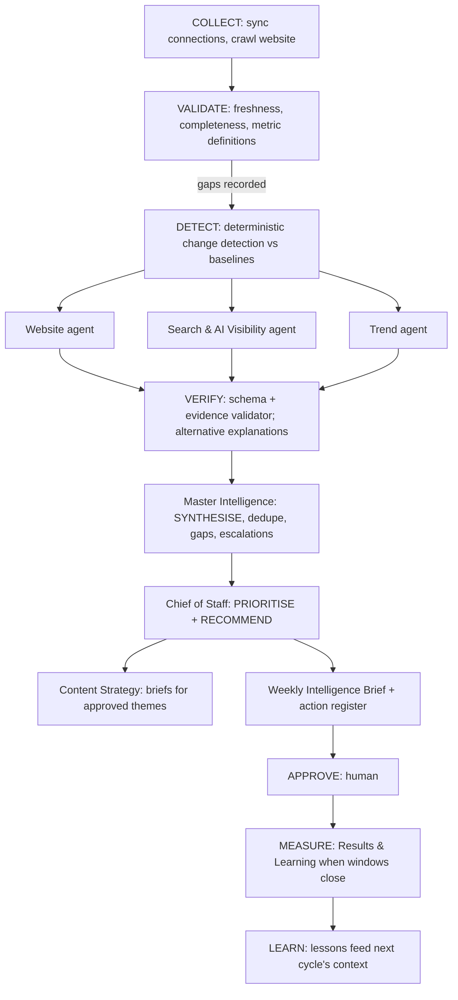

# Agent register and workflow map

The machine-readable register is `src/lib/agents/registry.ts` (purpose,
inputs, outputs, dependencies, data access, tools, required integrations,
triggers, approval gates, evaluation criteria, failure conditions, phase).
The customer Ecosystem and Activation pages render it directly, so what
customers are shown is what the orchestrator will run.

## 1. Agents

| Agent | Needs (any of) | Depends on | Approval gate | Phase |
|---|---|---|---|---|
| Master Intelligence | website / GA4 / GSC | all specialists' validated findings | — | 3 |
| Website Intelligence | website (+GA4, GSC) | — | any site change (out of scope) | 3 |
| Search & AI Visibility | GSC / website | — | — | 3 |
| Content Strategy | website / GSC | Website, Search | publishing | 3 |
| Results & Learning | GA4 / GSC | action register | — | 3 |
| Trend Intelligence | none (public research) | — | — | 3 |
| Chief of Staff (prioritisation) | — | Master | moving actions to Approved | 3 |
| Social Intelligence | Instagram / Facebook / YouTube | — | publishing (future) | 4 |
| Paid Campaign Intelligence | Google Ads / Meta Ads | — | any campaign change (not supported) | 4 |
| Visitor Growth | GA4 / booking | Website, Search, Paid | — | 5 |
| Pricing & Revenue | booking | — | any price change (never automated) | 5 |

Agents never call each other. They read validated findings and
observations through orchestrator-provided, tenant-scoped tools.

## 2. Workflows

A workflow is versioned code: an ordered list of steps, each bound to one
agent, with typed input/output schemas and explicit dependencies.

### W1 — Weekly intelligence cycle (Phase 3)



- **COLLECT / VALIDATE / DETECT are code, not LLM calls.** Statistical
  change detection (period-over-period with minimum volume thresholds)
  decides what is "significant"; the model explains and investigates.
- Specialists run in parallel; results enter the Message Batches API when
  latency doesn't matter (weekly scans) for lower cost.
- Duplicate prevention: workflow run idempotency key =
  `(organizationId, workflowKey, periodStart)`; singleton job key.
- A step whose required data is missing is **skipped with a recorded
  limitation**, never run on assumptions.

### W2 — Onboarding baseline (Phase 2/3)
Sync backfill → validation report (stage 4) → KPI baselines → first
Website & Search Report.

### W3 — Alert evaluation (daily, Phase 3/4)
Deterministic thresholds on fresh observations (traffic drops, crawl
errors, spend spikes, tracking breaks) → specialist explanation only when
an alert fires → notification.

### W4 — Outcome measurement (event-driven, Phase 3)
When an approved action's measurement window closes → Results & Learning
compares against the stated baseline and method → outcome + lesson.

## 3. Evidence standard (all agents)

Every output item is validated against this shape (Zod, enforced before
storage):

```ts
{
  label: "FACT" | "INTERPRETATION" | "RECOMMENDATION" | "UNKNOWN",
  statement: string,
  evidence: Array<{
    kind: "observation" | "page" | "external",
    ref: string,               // observation/page id or URL
    retrievedAt: string,
    reportingPeriod?: { start: string, end: string },
    metricDefinition?: string,
  }>,
  confidence: "high" | "medium" | "low",
  limitations: string[],
  conflicts?: string[],         // preserved disagreements between sources
}
```

Validator rules: FACT requires ≥1 non-external evidence ref or a dated
credible external source; numbers in a statement must appear in referenced
observations; RECOMMENDATION must carry measurement criteria; estimated
impact must be labelled as an estimate; UNKNOWN is the required label when
data is missing.

## 4. Evaluation plan

- **Golden datasets** per analytical task (fixture GA4/GSC exports and
  crawl fixtures with known answers: broken links, top declining pages,
  query gaps).
- **Adversarial sets:** missing data, contradictory sources, wrong
  customer assumptions, unreliable external content, and prompt-injection
  pages ("ignore previous instructions…", hidden text, instructions in
  structured data).
- **Acceptance criteria** are explicit and machine-checked (precision/
  recall on known issues, zero unsourced FACTs, zero cross-metric sums,
  injection success rate = 0), not "does the report sound convincing".
- Evals run in CI against recorded fixtures; live-model eval runs are
  budgeted and run before each prompt/model change.

## 5. Model usage

Default `claude-opus-5-5` with adaptive thinking and per-step effort;
structured outputs for all results; prompt caching of the stable prefix
(platform instructions → industry knowledge → tenant knowledge); Message
Batches for scheduled work; per-tenant usage ledger and budget enforcement
from the licence. Any cheaper model per step is chosen from eval results
by the product owner.
