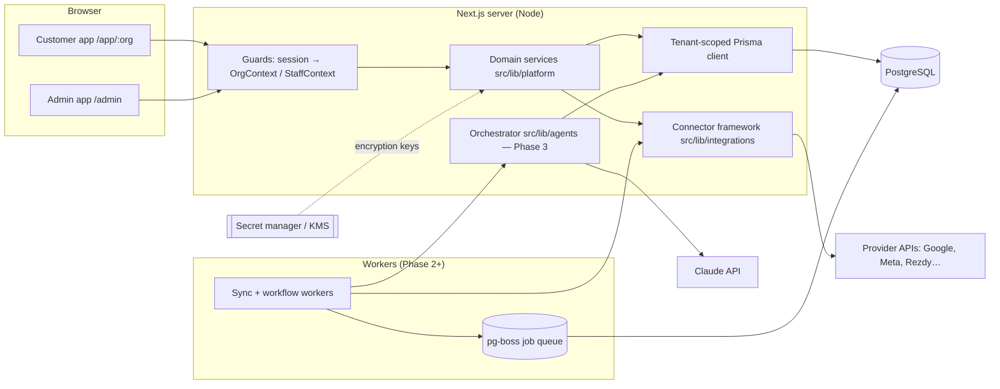

# Licensed AI Tourism Intelligence Platform — Architecture

Status: Phase 0 complete, Phase 1 implemented (2026-10-13). Companion documents:

| Document | Contents |
|---|---|
| [DATA_MODEL.md](DATA_MODEL.md) | Database schema, current and planned |
| [SECURITY.md](SECURITY.md) | Tenant/authorisation model, threat model, data flows, retention, incident response |
| [INTEGRATIONS.md](INTEGRATIONS.md) | Connector framework, integration matrix, OAuth/API prerequisites, blockers |
| [AGENT_REGISTER.md](AGENT_REGISTER.md) | Agents, workflows, evidence standard, orchestration design |
| [ROADMAP.md](ROADMAP.md) | Phases, backlog, risks, costs, milestone acceptance tests, open decisions |

## 1. Starting point

The repository held a single-destination MVP ("Rotorua Visitor Growth & Flow
Intelligence", see `docs/ARCHITECTURE.md`): Next.js 16 + Prisma/Postgres, a
governed observation schema, CSV import, two keyless connectors, a Scenario
Engine and an AI Discovery runner. It had **no authentication** — a
browser-settable cookie chose the role, so anyone could act as ADMIN — and no
concept of customers or tenants.

Decision: **evolve this repository rather than start again.** The stack is
sound for the product, the evidence/governance conventions carry straight
over, and the destination dashboard is useful as an internal tool. The
platform is added alongside it; the destination dashboard is moved under
`/destination` and restricted to platform staff (the dev role cookie was
removed).

## 2. System architecture

Layers (matching the brief's §4):

| Layer | Where | Phase 1 status |
|---|---|---|
| A. Customer application | `src/app/app/[org]/*`, `src/app/(auth)`, `src/app/workspaces` | Built: sign-up/in, workspaces, onboarding stages 1–5, brands, connection centre, ecosystem, licence, team, data & privacy. Reports/actions show honest empty states. |
| B. Administrative application | `src/app/admin/*` | Built: overview, customers, licence grant/update, products & plans, integration health, audit log. Execution history, cost and support views arrive with the layers that produce that data. |
| C. Integration layer | `src/lib/integrations/` | Connector contract, catalogue and connection lifecycle built; website domain capture live; provider connectors from Phase 2. |
| D. Shared data layer | `prisma/schema.prisma` | Tenant, licence, profile, brand, connection, audit tables built. Observation/finding/action tables designed (DATA_MODEL.md), built in Phases 2–3. |
| E. AI orchestration | `src/lib/agents/` | Agent register is code; orchestrator in Phase 3. |
| F. Scheduling | — | Designed (pg-boss); built in Phase 2 with the first sync jobs. |
| G. Security & governance | throughout | Built: auth, sessions, tenant isolation, RBAC, licence enforcement, encryption, audit, rate limiting, headers. |

### Request path (every customer action)

1. `requireOrg(slug)` validates the session cookie → user, then checks
   membership in that organisation (non-members get **404**, so slugs can't
   be probed) and builds an `OrgContext` with a **tenant-scoped db client**.
2. The server action passes raw form fields to a domain service.
3. The service checks **role** (`requirePermission`), **licence**
   (`assertCanOperate` / `assertFeature`) and **plan limits**
   (`assertWithinLimit`), validates input with Zod, writes through the
   tenant client and records an **audit event**.
4. Errors map to customer-safe messages (`runAction`); unknown errors are
   logged server-side and reported generically.

The UI hides controls a role can't use, but hiding is never the enforcement.

## 3. Technology stack and rationale

| Concern | Choice | Why / alternatives |
|---|---|---|
| Web framework | **Next.js 16 App Router, TypeScript** (existing) | Server Components + Server Actions keep secrets and privileged logic server-side by default; one deployable for app, admin and API. |
| Database | **PostgreSQL + Prisma 6** (existing) | Relational integrity for tenancy/licensing, JSONB for typed configuration, arrays, mature migrations. RLS available as a further isolation layer. Prisma 7 migration (config file) is a small backlog item. |
| Authentication | **Own DB-backed sessions** (scrypt passwords, opaque hashed session tokens, HttpOnly `__Host-` cookie) | Fully understood, testable, no vendor coupling for the pilot. **Before enterprise sales**, add SSO/MFA via a managed IdP (WorkOS / Clerk / Auth0) behind the same `getCurrentUser()` seam. Email verification and password reset need an email provider (Phase 1 gap). |
| Authorisation | Membership roles (OWNER/ADMIN/MEMBER/VIEWER) + platform roles (SUPPORT/SUPER_ADMIN), enforced in services | See SECURITY.md. |
| Background jobs | **pg-boss** (Postgres-backed queue) — Phase 2 | Durable, retryable, cron schedules, singleton keys for duplicate prevention, no extra infrastructure. Move to Temporal/Inngest only if workflows outgrow it. |
| Secrets | Env-injected key ring now (`CREDENTIAL_ENCRYPTION_KEYS`) → cloud KMS envelope encryption before production | AES-256-GCM, versioned keys, row-bound AAD (src/lib/platform/crypto.ts). |
| File/document storage | S3-compatible object storage (Phase 2/3) | Reference documents, crawl snapshots, report exports. Tenant-prefixed keys, server-generated signed URLs only. |
| Claude integration | **Official `@anthropic-ai/sdk`, Messages API, self-orchestrated workflows** — Phase 3 | See §5. |
| Email | **Amazon SES (Sydney)** behind `email.ts`; file/memory transports for dev/CI/tests | Same region as the data; IAM credentials, no API keys. |
| Billing | **Stripe** (Billing + Customer Portal + webhooks) — after pilot pricing is set | Licence rows already carry `billingProvider` / external ids; webhooks will be the only path that sets paid statuses. Manual staff provisioning until then. |
| Hosting | **AWS ap-southeast-2 (Sydney)**: ECS Fargate (web + worker), RDS PostgreSQL, S3, Secrets Manager/KMS — see HOSTING.md | Decision 2026-10-14. Container image (`Dockerfile`) keeps it portable. Not yet provisioned. |
| CI/CD | GitHub Actions: lint, types, tests, build, browser smoke, audit gates, gitleaks, container builds; deploy gated on CI | `.github/workflows/` |
| Monitoring | Sentry (errors), OpenTelemetry traces, structured logs | Phase 6, with per-tenant cost dashboards. |
| Tests | **Vitest** unit + integration against a real Postgres test database; Playwright end-to-end | 108 automated tests plus a 31-check browser smoke run, all in CI. |

## 4. Multi-tenancy model (summary — detail in SECURITY.md)

- **Organization = tenant.** Every tenant-owned row has a non-null
  `organizationId`. Users can belong to many organisations (agencies, staff
  with several brands).
- **Tenant-scoped Prisma client** (`tenantDb(orgId)`) rewrites every query
  on tenant models to filter/stamp `organizationId` and throws if a query
  names another organisation. Services only ever receive this client.
- **Cross-tenant access** exists only in `src/lib/platform/admin.ts`, gated
  on platform role, and each view of a customer is audited.
- Planned: Postgres row-level security (Phase 6) as a third layer.

## 5. AI orchestration design (Phase 3)

Decision: **self-orchestrated workflows on the Claude Messages API**, not a
free-roaming multi-agent system and not Managed Agents for now.

- **Why self-orchestrated:** the agents' value comes from deterministic,
  auditable workflows over *tenant-scoped data we host*. Our code decides
  which agent runs, with which context, and validates every output; Claude
  does the analysis inside each step. Data-access tools are our own
  functions over the tenant client, so a model can never reach another
  tenant's data or a provider credential.
- **Managed Agents** (Anthropic-hosted loop + sandbox, scheduled
  deployments) is worth re-evaluating for the Trend research agent, but
  would mean sending tenant data into a hosted sandbox; not needed for v1.
- **Model:** default `claude-opus-5-5` with adaptive thinking; effort set per
  agent (`low` for extraction/classification steps, `high` for synthesis).
  Model and effort are per-agent configuration, so cheaper tiers
  (`claude-sonnet-5-5`, `claude-haiku-5-5`) can be chosen per step once evals
  show quality holds — a business decision, not something to assume.
- **Typed outputs:** structured outputs (`output_config.format` /
  `messages.parse` with Zod) for every agent result; strict tool schemas for
  data tools. Outputs failing validation get one repair attempt, then the
  step fails visibly.
- **Evidence:** every finding carries FACT / INTERPRETATION /
  RECOMMENDATION / UNKNOWN labels and source references to observation rows
  (AGENT_REGISTER.md §3). The validator rejects material claims without
  sources.
- **Research tools:** server-side `web_search` / `web_fetch` with
  `allowed_domains`; fetched content is untrusted data — it is quoted inside
  delimited data blocks, never concatenated into instructions, and agents
  have no tool that can take consequential action.
- **Cost controls:** prompt caching (stable system prompt + tenant
  knowledge first), Message Batches API (50% cheaper) for scheduled weekly
  scans, per-tenant usage ledger from `response.usage`, hard monthly budget
  from the licence's `monthlyModelBudgetUsd` checked before each run.
- **Refusals / failures:** check `stop_reason` before reading content;
  server-side fallbacks enabled; retries with backoff on 429/5xx only.

Note: the legacy destination code (`src/lib/llm/anthropic.ts`) calls the API
with raw `fetch` and a hard-coded model id. It is untouched in Phase 1 and
will be migrated to the SDK in Phase 3.

## 6. Separation of knowledge

| Kind | Lives in | Shared across tenants? |
|---|---|---|
| Universal platform instructions (evidence rules, safety, output schemas) | Code (`src/lib/agents/*`), versioned with the product | Yes |
| Industry knowledge (tourism concepts, seasonality heuristics, metric definitions) | Code/config per ecosystem product | Yes |
| Customer information (profile, knowledge, brands, data) | Tenant rows | **Never** |

## 7. What is real vs. not yet built

Real and tested: everything in the "Phase 1 status" column above. Not built
and **not faked**: provider connectors, crawling, sync jobs, agents,
reports, billing, email. The UI states these plainly ("Coming in phase 2",
"Not yet validated", disabled activation) rather than showing sample data.
