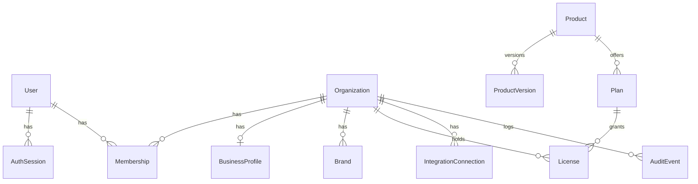

# Data model

Source of truth: `prisma/schema.prisma`. Migration for Phase 1:
`prisma/migrations/20261013060510_platform_foundation`.

## Phase 1 — built



| Table | Tenant-scoped | Notes |
|---|---|---|
| `User` | no (global identity) | Lower-cased unique email, scrypt hash, `platformRole` (NONE/SUPPORT/SUPER_ADMIN — only settable via CLI), `disabledAt`. |
| `AuthSession` | no | SHA-256 of the cookie token only; absolute expiry, idle timeout via `lastSeenAt`, `revokedAt`. |
| `Organization` | is the tenant | `slug` (URL), `status` (ACTIVE / DELETION_REQUESTED), `onboardingStage`. |
| `Membership` | yes | `(organizationId, userId)` unique; role OWNER/ADMIN/MEMBER/VIEWER. |
| `Product` / `ProductVersion` | no | Ecosystem catalogue; versions carry release notes. |
| `Plan` | no | Commercial rules as data: interval, optional price, `selfServeTrial`, `trialDays`, `entitlements` JSON (validated by `EntitlementsSchema`). |
| `License` | yes | One per (organisation, product). Status, trial/period dates, grace days, `entitlementOverrides`, billing-provider references. |
| `BusinessProfile` | yes (1:1) | Onboarding stage 1 and 2 fields; list fields are `text[]`. |
| `Brand` | yes | Unique name per organisation. |
| `IntegrationConnection` | yes | Provider key + external account id (unique per org), status, scopes, encrypted credentials, sync timestamps, last error. Revoked rows are kept for history with credentials destroyed. |
| `AuditEvent` | yes (nullable for platform events) | Actor id + denormalised email + IP, action, target, metadata. |
| `RateLimitBucket` | no | Fixed-window counters updated atomically in SQL. |
| `UserToken` | no (user-scoped) | Hashed single-use email-verification and password-reset tokens, bound to the address they were sent to. |
| `Invitation` | yes | Hashed 7-day invitation token, email, role, accepted/revoked timestamps. |
| `ModelRate` | no | Claude list prices in integer micro-USD per million tokens, versioned by `effectiveFrom`. |
| `UsageRecord` | yes | One row per model call: tokens by type, batch flag, computed cost; unique per provider request id. |
| `UsageAlert` | yes | Warning / limit notices raised once per organisation per month. |

### Entitlements JSON

```jsonc
{
  "features": { "integrations.ga4": true, "reports.weekly_brief": true /* … */ },
  "limits": { "brands": 3, "users": 5, "integrations": 6,
              "historyDays": 365, "customWorkflows": 2 },   // null = custom / no limit
  "reporting": { "cadences": ["daily", "weekly"] },
  "support": { "tier": "priority" },
  "ai": { "monthlyAllowanceUsd": 80, "warnAtPercent": 80, "hardLimitPercent": 110 }  // never unlimited
}
```

Features not listed are **off**; limits not listed are **0** — nothing is
granted by omission. Licence overrides merge over the plan.

## Legacy destination tables (unchanged)

`Destination`, `DataSource`, `VisitorMetric`, … `ScenarioQuery` — see
`docs/ARCHITECTURE.md`. They are destination-scoped, not tenant-scoped, and
are reachable only by platform staff. When the destination product is
licensed, `Destination` will gain an `organizationId`.

## Planned tables (Phases 2–5)

Designed now so connectors and agents share one shape. All are
tenant-scoped (`organizationId` non-null, added to `TENANT_MODELS`).

| Table | Phase | Purpose / key columns |
|---|---|---|
| `SyncRun` | 2 | One execution of a connector sync: connection, window, status, rows, cursor, `dataCompleteThrough`, error kind, attempt, job id (unique → duplicate protection). |
| `MetricObservation` | 2 | Normalised fact row: `connectionId`, `providerKey`, `metricKey` (provider-native name, e.g. GA4 `sessions`, GSC `clicks`), `metricDefinitionId`, value, unit, **currency**, **time zone**, period start/end, dimensions JSONB (page, query, channel, device, country…), `sampled`/`thresholded` flags, `retrievedAt`. Unique on (connection, metric, period, dimension hash) for idempotent re-sync. |
| `MetricDefinition` | 2 | Per provider + metric: definition text, attribution model/window, aggregation rules, documented caveats. Metrics from different providers are never summed unless definitions declare them compatible. |
| `WebPage` / `WebPageSnapshot` / `CrawlIssue` | 2 | Inventory per site: URL, canonical, status, title, meta, headings, structured data, content hash (change tracking, duplicate detection), word count, internal links; issues with severity. |
| `Baseline` | 2 | KPI baselines (metric, period, value, method) used by Results & Learning. |
| `WorkflowRun` / `AgentRun` | 3 | Orchestrator executions: workflow key, version, trigger, idempotency key, status, model, effort, input/output token usage, cost, prompt version, error. |
| `Finding` | 3 | Agent output item: agent, label (FACT/INTERPRETATION/RECOMMENDATION/UNKNOWN), statement, confidence, limitations, period, status (validated/rejected). |
| `EvidenceRef` | 3 | Finding → observation/page/external source (URL, retrieval date, quoted excerpt hash). |
| `Recommendation` / `Action` | 3 | Action register: issue, evidence, relevance, confidence, estimated impact (labelled estimate), effort, urgency, dependencies, next step, measurement criteria, status (PROPOSED → AWAITING_APPROVAL → APPROVED → IN_PROGRESS → COMPLETED → MEASURED / REJECTED / SUPERSEDED), notes, approver, timestamps. |
| `Outcome` / `Lesson` | 3 | Measured result vs. baseline with method and caveats; lessons and data limitations. |
| `Report` | 3 | Rendered brief with immutable JSON body referencing findings. |
| `Notification` | 3 | Alerts and digests per user. |
| `Booking` | 5 | Pseudonymous booking facts: provider booking id (hashed), created/activity dates, product, status, value + currency, party size, refund, referral/campaign code. No traveller PII by default. |
| `KnowledgeDocument` | 3 | Approved reference documents (object storage key, checksum, approval). |

Design rules carried from the original project: every observation keeps its
source, retrieval time, reporting period and limitations; derived rows
reference their evidence; nothing is seeded that pretends to be an
observation.
